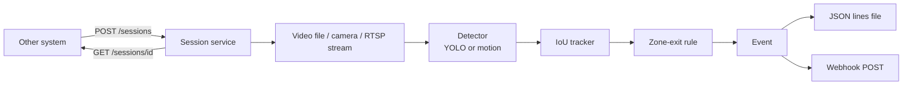

# zone-exit-detector

Detects vehicles that start moving out of a zone you draw on a camera image, and reports each one as an event. It can run on a video file or stream from the command line, or as a small HTTP service that another system starts for one call on one camera.

Typical use: a camera watching the door of a garage or depot, and a system that needs to know when a vehicle has actually left.

This is a demonstration project written for a portfolio. It contains no code, data or configuration from any employer or client.

## How it works



1. A **detector** returns boxes for each frame. `yolo` uses Ultralytics YOLO (cars, buses, trucks by default). `motion` uses background subtraction and needs no model, which is useful for a first test.
2. A small **IoU tracker** gives each box an id that stays the same across frames.
3. The **zone rule** remembers where each vehicle first appeared inside the zone. It fires once, when the vehicle has been in the zone for at least `min_time_in_zone_s` and has moved `min_distance_px` in the allowed direction (`left_to_right`, `right_to_left`, `top_to_bottom`, `bottom_to_top` or `any`).
4. Events are printed, appended to a `.jsonl` file and optionally posted to a webhook in a background thread, so a slow server never blocks frame processing.

## Quick start (command line)

```bash
pip install -r requirements.txt
pip install -r requirements-yolo.txt      # optional, for the YOLO detector

cp config.example.yaml config.yaml
python -m zone_exit zone --source my_video.mp4        # click the zone corners, press Enter
python -m zone_exit run  --source my_video.mp4 --show
```

`--source` accepts a video file, a camera index (`0`) or an `rtsp://` / `http://` URL. Streams reconnect automatically if they drop. Use `--save-video out.mp4` to write an annotated copy. To try it without a model, keep `detector.type: motion` (the default).

## Service mode

Configure your cameras in `config.yaml` (see `config.example.yaml`): each has a source, its own zone file and optionally its own rule. Put stream addresses that contain passwords in environment variables (`source: ${GATE1_URL}`), not in the file.

```bash
export ZONE_EXIT_TOKEN="choose-a-long-random-token"
export GATE1_URL="rtsp://..."
python -m zone_exit serve --config config.yaml          # listens on 127.0.0.1:8080
```

```bash
# start watching camera gate1 for call 123 (gives up after 60 s)
curl -X POST localhost:8080/sessions -H "Authorization: Bearer $ZONE_EXIT_TOKEN" \
     -H "Content-Type: application/json" \
     -d '{"call_id": "123", "camera_id": "gate1", "timeout_s": 60}'

curl localhost:8080/sessions/123 -H "Authorization: Bearer $ZONE_EXIT_TOKEN"     # state + events
curl -X DELETE localhost:8080/sessions/123 -H "Authorization: Bearer $ZONE_EXIT_TOKEN"   # stop
```

A session ends in one of these states: `detected`, `timeout`, `stopped`, `ended` (a video file finished), `error`. When a vehicle is detected, or a session times out, the event is also sent to the configured webhook, with the `call_id` included.

Behaviour worth knowing:
- Every route except `/health` needs the bearer token. The service refuses to start without one unless you pass `--no-auth`.
- It binds to `127.0.0.1` by default. Put it behind a reverse proxy with TLS if it must be reachable from elsewhere.
- Starting and stopping use POST and DELETE. A GET never changes anything.
- At most `api.max_sessions` sessions run at once (HTTP 429 otherwise), a second session for the same call is rejected (409), and every session has a timeout.
- Finished sessions are kept for `api.retention_s` seconds and then removed.
- Responses never contain stream addresses.
- With the YOLO detector one model is loaded and shared by all sessions.

## Event format

```json
{"event": "zone_exit", "track_id": 2, "frame": 26, "dx": 42.0, "dy": 0.0,
 "seconds_in_zone": 0.32, "time": "2026-10-14T11:02:29+00:00", "video_time_s": 1.04,
 "call_id": "123", "camera_id": "gate1"}
```

`video_time_s` appears for video files, `call_id` and `camera_id` in service mode. A timeout sends `{"event": "timeout", "call_id": ..., "camera_id": ..., "time": ...}`.

## Tests

```bash
python -m unittest discover -v
```

The tests cover the geometry, tracker and zone rule with plain numbers, an end-to-end run on a generated video, and the HTTP service (authentication, validation, session limits, stopping, timeouts). The YOLO adapter is a thin wrapper around Ultralytics and is not covered by the automated tests.

## Design notes

- The zone rule is pure logic. It takes timestamps as arguments instead of reading a clock, which keeps it easy to test.
- The detector is behind a one-method interface (`detect(frame) -> boxes`), so another model can be added without touching the rest.
- Configuration is read once at start-up. Zones are stored as normalized coordinates, so they survive a change of video resolution.

## Limitations

- The IoU tracker is deliberately simple. It can swap ids when vehicles overlap heavily. For busy scenes use a stronger tracker such as ByteTrack.
- The motion detector reports anything that moves and is sensitive to lighting changes.
- There is no model training or accuracy evaluation here. The YOLO detector uses pretrained weights as they come.
- The webhook has no authentication or retry, and sessions are kept in memory, so they are lost when the service restarts.

## License

MIT
